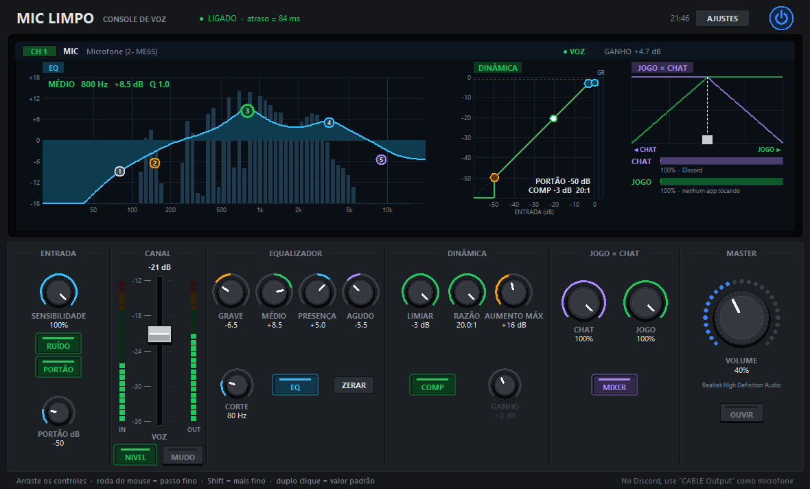

# 🎙️ Mic Limpo

**Um console de voz para Windows com cara de mesa de som:** supressão de ruído com IA, equalizador gráfico, nivelador automático de volume, compressor/limitador e equilíbrio **jogo × chat**, tudo numa janela leve que usa **~30 MB de RAM e menos de 1% de CPU**.



Ele pega o microfone de verdade, trata a voz em tempo real e entrega o resultado num microfone virtual. No Discord (ou em qualquer jogo/app) você só escolhe esse microfone virtual.

---

## Por que eu fiz isso

Meu PC estava ficando lento até travar no meio do jogo. Investigando, descobri que o serviço de captura do software que eu usava para o microfone estava **vazando memória**: passava de 20 GB e esgotava a RAM. Desinstalei, mas aí perdi a supressão de ruído e o ajuste de volume do microfone, que eu usava o tempo todo.

Então construí o meu: só o que eu preciso, leve, e com o visual de uma mesa de som de verdade.

## O que ele faz

- **Supressão de ruído com IA** ([RNNoise](https://github.com/xiph/rnnoise)): tira ventilador, teclado, chiado.
- **Portão inteligente:** fecha o microfone quando você não está falando, combinando a detecção de voz da IA com um limiar de nível (bom contra TV e vozes distantes).
- **Equalizador gráfico de 5 bandas:** pontos arrastáveis sobre o espectro da sua voz ao vivo. A curva desenhada é exatamente o filtro aplicado no áudio.
- **Nivelador automático:** sobe a voz baixa e abaixa a alta sozinho, aprende o seu ganho e lembra dele na próxima vez.
- **Compressor + limitador:** curva entrada × saída editável no gráfico, com uma bolinha mostrando a sua voz em tempo real. Gritos não estouram (o limitador antecipa o pico dentro do quadro).
- **Jogo × chat:** crossfader e knobs que controlam o volume de cada aplicativo pelo mixer do Windows (Discord/Teams = chat, o resto = jogo). Nenhum áudio extra passa pelo programa e os volumes originais voltam ao fechar.
- **Volume geral, mudo, retorno para ouvir a própria voz**, inicia com o Windows e reconecta sozinho se o microfone for desplugado.

## Como funciona

```
Microfone ─► RNNoise ─► EQ ─► Nivelador ─► Portão ─► Compressor ─► Limitador ─► CABLE Input
                                                                                     ║  VB-CABLE
                                                    Discord / jogos ◄── CABLE Output ◄╝
```

O áudio é processado em quadros de 10 ms a 48 kHz. O atraso total fica em torno de **85 ms** (captura + processamento + saída), imperceptível numa chamada de voz.

## Requisitos

- Windows 10 ou 11
- [Python 3.12+](https://www.python.org/downloads/) (desenvolvido e testado no 3.14)
- [VB-CABLE](https://vb-audio.com/Cable/), o driver gratuito de cabo de áudio virtual da VB-Audio. Ele cria o "microfone virtual" que o Discord vai usar.

## Instalação

```bash
git clone https://github.com/Tocdor-creator/mic-limpo.git
cd mic-limpo
python -m venv .venv
.venv\Scripts\pip install -r requirements.txt
.venv\Scripts\pip install --no-deps pyrnnoise
.venv\Scripts\python -m mic_limpo.atalhos
```

O último comando cria um atalho **Mic Limpo** na área de trabalho. Também dá para abrir com `.venv\Scripts\pythonw iniciar.pyw`.

> Do pacote `pyrnnoise` só é usado o `rnnoise.dll` que vem dentro dele, por isso o `--no-deps`: as dependências dele (FFmpeg, matplotlib) somariam ~200 MB de RAM sem necessidade.

## Configurando (uma vez só)

1. **Windows:** depois de instalar o VB-CABLE, confira se a **saída de som** do Windows continua sendo o seu fone/caixa, e não o `CABLE Input` (o instalador às vezes troca). Se o cabo ficar como saída, o som do PC entra no seu microfone; o Mic Limpo mostra um aviso vermelho quando isso acontece.
2. **Discord** → Configurações → Voz e vídeo:
   - **Dispositivo de entrada:** `CABLE Output (VB-Audio Virtual Cable)`
   - **Dispositivo de saída:** o seu fone/caixa
   - Desligue a **supressão de ruído** e o **controle automático de ganho** do Discord, porque o Mic Limpo já faz isso.
3. No Mic Limpo, em **AJUSTES**, escolha o seu microfone e marque **Iniciar com o Windows**.

## Usando

Em todos os controles: **arrastar** ajusta, **roda do mouse** dá passos, **Shift** deixa mais fino e **duplo clique** volta ao padrão. A barra de baixo explica o controle que está sob o mouse.

### A tela

| Gráfico | O que dá para fazer |
|---|---|
| **EQ** | 5 pontos sobre o espectro ao vivo: 1 corte de graves, 2 grave, 3 médio, 4 presença, 5 agudo. Lados = frequência, cima/baixo = volume, roda = largura (Q). |
| **Dinâmica** | Curva entrada × saída. Alça laranja = portão; alça do joelho = limiar do compressor; alça da direita = razão; linha vermelha = limitador. A barra GR mostra quanto está sendo segurado. |
| **Jogo × chat** | Crossfader entre chat e jogo, com o volume de cada grupo, o pico ao vivo e quais apps estão tocando. |

### A superfície

| Seção | Controles |
|---|---|
| Entrada | Sensibilidade da voz, **RUÍDO** (IA), **PORTÃO** e o limiar do portão |
| Canal | Fader **VOZ** (volume que o nivelador busca), medidores IN/OUT, **NIVEL** e **MUDO** |
| Equalizador | Grave, médio, presença, agudo, corte, **EQ** liga/desliga e **ZERAR** |
| Dinâmica | Limiar e razão do compressor, aumento máximo do nivelador, **COMP** e ganho manual |
| Jogo × chat | Knobs **CHAT** e **JOGO** e **MIXER** liga/desliga |
| Master | Volume geral do Windows e **OUVIR** (escuta a própria voz já tratada) |

## Desempenho

Medido num notebook com 8 threads, microfone ligado e tela atualizando:

| | |
|---|---|
| Memória | ~30 MB, estável (sem crescer com o tempo) |
| CPU | ~0,8% do processador |
| Processamento por quadro de 10 ms | ~1 ms (RNNoise + EQ + dinâmica) |
| Atraso | ~85 ms |

Dois cuidados fizeram diferença: carregar só o DLL do RNNoise (em vez do pacote inteiro) e limitar o OpenBLAS do numpy a uma thread, que sozinho reservava ~225 MB à toa. Na interface, cada item do Canvas só é redesenhado quando muda, o que levou o custo da tela de 67% para ~8% de um núcleo.

## Detalhes técnicos

- **Áudio:** `sounddevice` (PortAudio/WASAPI). Microfone e cabo têm relógios diferentes, então cada saída tem uma fila que guarda ~30 ms e absorve a deriva.
- **EQ:** as bandas (fórmulas do *Audio EQ Cookbook*) viram um **FIR de fase mínima** calculado por cepstro e aplicado por FFT (overlap-save). Resultado: a resposta é idêntica à curva da tela e não há atraso extra.
- **Nivelador:** mede a potência só nos quadros com voz (probabilidade do RNNoise), sobe devagar (~12 dB/s), desce rápido e ignora vozes baixas demais para serem você.
- **Limitador:** analisa o pico de cada bloco de 1 ms dentro do quadro e já chega abaixado nele, sem cortar o começo de um grito.
- **Jogo × chat:** Core Audio do Windows (`IAudioSessionManager2`, `ISimpleAudioVolume`, `IAudioMeterInformation`) chamado direto por `ctypes`, sem dependências, com liberação automática de cada interface COM.
- **Interface:** `tkinter`, tudo desenhado num único `Canvas` (knobs, faders, LEDs, gráficos).

## Testes

```bash
.venv\Scripts\python testes\teste_processador.py   # cadeia de efeitos com sinal sintético
.venv\Scripts\python testes\teste_eq.py            # áudio filtrado = curva desenhada
.venv\Scripts\python testes\teste_mixer.py         # volume por app (só numa sessão do próprio teste)
.venv\Scripts\python testes\teste_janela.py        # simula arrastos e cliques na mesa
.venv\Scripts\python testes\teste_rota.py          # mic real -> CABLE Output (só mede, não grava)
```

## Estrutura

```
mic_limpo/
  processador.py   cadeia de efeitos por quadro de 10 ms
  eq.py            bandas -> FIR de fase mínima
  motor.py         streams WASAPI e filas
  mixer.py         jogo × chat via Core Audio
  janela.py        a mesa (layout e lógica)
  widgets.py       knob, fader, botão aceso, medidor de LED
  graficos.py      gráficos de EQ, dinâmica e jogo × chat
  dispositivos.py  config.py  atalhos.py
ferramentas/       ícone, diagnósticos de voz e de sessões de áudio, print da janela
testes/
```

Preferências ficam em `%APPDATA%\MicLimpo\config.json` e erros em `%APPDATA%\MicLimpo\erro.log`.

## Créditos

- [RNNoise](https://github.com/xiph/rnnoise) (Xiph.Org / Jean-Marc Valin, licença BSD), usado via o DLL distribuído pelo [pyrnnoise](https://pypi.org/project/pyrnnoise/) (Apache-2.0)
- [VB-CABLE](https://vb-audio.com/Cable/) da VB-Audio (donationware; instalado à parte, não incluído aqui)
- [numpy](https://numpy.org/) e [python-sounddevice](https://python-sounddevice.readthedocs.io/) / PortAudio
- Visual inspirado em mesas de som digitais. Projeto independente, sem vínculo com fabricantes de áudio.

## Licença

[MIT](LICENSE)
